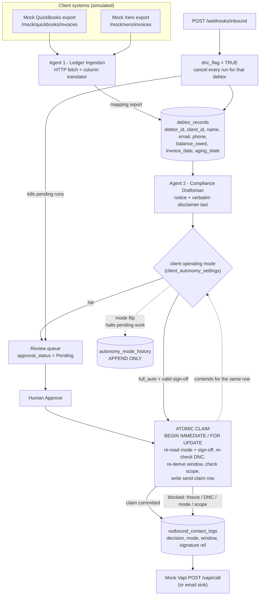
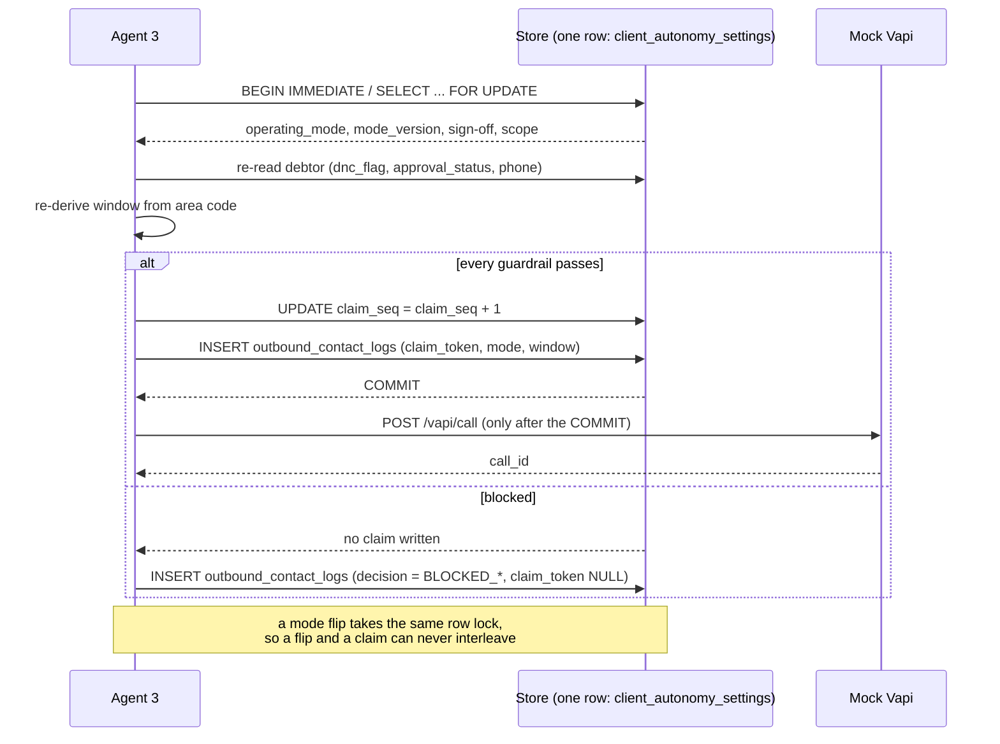

# RecoverAI engine architecture

> **Staleness note (engineer, 2026-10-07).** This document is the Phase-1 picture and has not
> been kept current. The module table below predates the payment engine (`engine/payments.py`),
> the lifecycle gate (`engine/gate.py`) and the reopen audit; the "four tables" line is wrong
> (the store now has twelve, including three evidence tables); and the claim sketch omits the
> reopen audit, the balance and the parked-adjustment refusals. The current authorities are
> `docs/schema.md` (tables and columns), `docs/gate.md` (the beta-to-full-active gate and the
> reopen-audit refusal) and `config/rulebook.json` (`guardrails`, `reopen_audit`). Fix or
> replace this file before anyone cites it again.

A compliant, client-controlled accounts-receivable pipeline. Three agents run in this
repository (ingestion, drafting, orchestration); the fourth (customer success) and the
web console are separate, later pieces of work.

Everything here runs offline. QuickBooks, Xero, Vapi and the email provider are local
mocks started by this process or by the test suite. No real call is placed, no email is
sent, no money moves, and no third-party API is contacted.

## Modules

| File | Role |
| --- | --- |
| `config/rulebook.json` | The single source of truth for tunable rules: calling window, opt-out keywords, the disclaimer, aging buckets, authorization scope options. Consumed as data. |
| `config/ingestion_aliases.json` | Column-alias table for the translator (Agent 1). |
| `config/clients.json` | Sandbox client directory used to render the contact path on a notice. |
| `engine/config.py` | Loads the rulebook/aliases and exposes accessors (`disclaimer()`, `window_bounds_minutes()`, `aging_state_for_days()`, `scope_options()`, ...). No rule is hard-coded in code. |
| `engine/clock.py` | One clock for every timestamp. `RECOVERAI_FAKE_NOW` pins it so a demo is deterministic. |
| `engine/timezones.py` | Area code → IANA timezone → derived local time → calling-window decision. Fail-closed on an unresolvable area code. |
| `engine/db.py` | Store over SQLite (default, stdlib) or Postgres (`DATABASE_URL` + a driver). `tx(immediate=True)` is the claim transaction. |
| `engine/schema.sql` | The four tables, the CHECK constraints, the append-only triggers. |
| `engine/ingest.py` | **Agent 1** — HTTP fetch + column translator + aging derivation + mapping report. |
| `engine/draft.py` | **Agent 2** — renders the past-due notice and appends the disclaimer verbatim, last. |
| `engine/orchestrator.py` | **Agent 3** — the claim-then-fire send path, the Vapi payload, blocked-attempt logging, scheduled runs. |
| `engine/onboarding.py` | Sign-off capture (hash reference), mode switching, revocation, expiry sweep, scope checks. |
| `engine/webhooks.py` | Inbound replies: the global STOP/Unsubscribe DNC kill. |
| `engine/runqueue.py` | Scheduled runs that a DNC opt-out or a mode flip can kill or halt. |
| `engine/audit.py` | Append-only guardrail/action log (`out/guardrail_actions.jsonl`). |
| `engine/app.py` | `RecoverAI` facade — the methods the console will call in the next task. |
| `mocks/server.py` | The mock vendor (QuickBooks/Xero exports, `/vapi/call`, email sink) and the engine API (`/webhooks/inbound`, `/onboarding/*`, `/mode/switch`, review queue). |
| `mocks/data/*.json` | The messy demo exports the vendor serves. |
| `run_demo.py` | The documented end-to-end demo. |
| `tests/` | The compliance, store, onboarding, ingestion, payload and race tests. |

## Pipeline

## The claim point

Every outbound contact passes through one transaction, and the order of checks inside it
is the rulebook's `guardrails.evaluation_order_at_claim` (**updated 2026-10-07** — this list was
written before the payment engine landed and had drifted from the code; it is kept in sync by
`tests/test_reopen_audit.py::test_the_rulebook_documents_this_invariant_and_the_token_matches_the_code`):

1. `dnc_flag` on the debtor record — an opt-out is absolute and beats everything below it,
2. `account_state = Pending_Adjustment_Confirmation` (a balance moved with no payment signal:
   parked, no dunning, no fee),
3. an open **reopen audit** (`Reopened_Awaiting_Audit`, or a `reversal_opened_audit` row with no
   completed audit) — refused with the token `REOPENED_AWAITING_AUDIT`, which is the one refusal
   that does not start with `BLOCKED_`,
4. `balance_owed` zero, negative or NULL (`BLOCKED_NO_BALANCE_DUE`: never demand money that is not
   owed),
5. the calling window, re-derived from the area code at claim time (voice/SMS only),
6. the operating mode — `full_auto` requires a valid, unrevoked, unexpired sign-off;
   `hitl` requires a human approval on the record,
7. the sign-off's authorization scope (channel × aging state),

and then, in the same transaction, the claim row is written and `claim_seq` is bumped on
the client's `client_autonomy_settings` row — the same row a mode flip writes. A blocked
attempt writes **no** claim: it is logged afterwards, outside the transaction, as audit
evidence.

## Guardrails that hold in every mode

* **Calling window** — derived from the phone area code, evaluated inside the claim
  transaction. Out of window: the run freezes and `approval_status` becomes exactly
  `Outside_Calling_Window`. An area code we cannot resolve fails closed the same way.
* **Global DNC opt-out** — an inbound string containing `STOP`, `Unsubscribe` or
  `Stop calling` (case-insensitive substring) sets `dnc_flag`, cancels every scheduled
  run for that debtor, and blocks every future claim.
* **Atomic send claim** — see above; there is no check-then-fire path anywhere in the
  codebase.
* **Verbatim disclaimer** — appended by `engine/draft.py` as the last content of every
  generation, exactly once, byte-identical to `config/rulebook.json`.

No operating mode, environment variable or configuration flag switches any of these off.
The only way to change a guardrail is to edit `config/rulebook.json` — and the window
boundaries and opt-out keywords are the rules the owner was told hold.

## Store and dialect

SQLite by default (`data/recoverai.db`), with the same SQL shape for Postgres: TEXT
timestamps, INTEGER booleans, JSON arrays in TEXT. `BEGIN IMMEDIATE` (SQLite) and
`SELECT ... FOR UPDATE` (Postgres) both serialise the claim against a mode flip. If
`DATABASE_URL` is set and a Postgres driver is importable, Postgres is used instead.

## Known limitations (restated from the business plan)

* Area-code-derived local time is the specified method and the weak point. It is stored
  on every record with the derived local clock so the decision is auditable, but a real
  deployment should source the timezone from billing address or carrier data.
* The authorization wording is drafted by the team, not reviewed by counsel.
* The Postgres path (driver, `FOR UPDATE`, the plpgsql append-only trigger) is shipped but
  was **not executed** in this sandbox: no Postgres driver is installed here.
